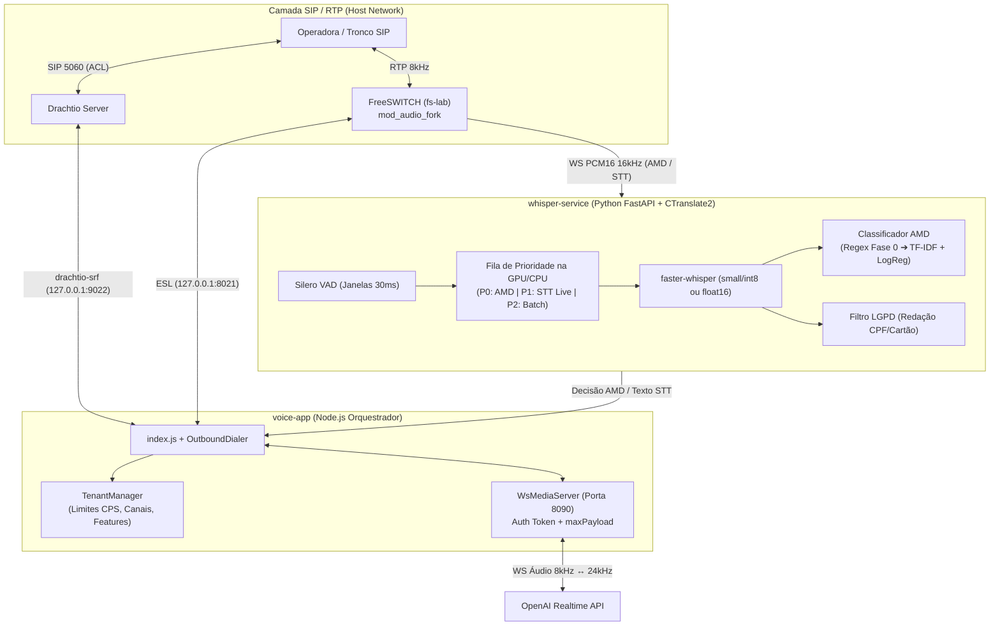

# Plano de Implantação em Produção: AMD + STT (`faster-whisper`) + Hardening no `voice-app`

> [!IMPORTANT]
> Este plano foi desenhado especificamente sobre a arquitetura atual do repositório **`voice-app`** ([index.js](../index.js), [media/ws-media-bridge.js](../media/ws-media-bridge.js), [utils/tenant-manager.js](../utils/tenant-manager.js) e [docker-compose.yml](../docker-compose.yml)).

---

## 1. Arquitetura Real no Projeto Atual

Em vez de compilar o módulo externo `mod_audio_stream` (AGPL-3.0), utilizaremos o **`mod_audio_fork`** que **já está instalado e rodando** no container `drachtio/drachtio-freeswitch-mrf` (`fs-lab`).

O novo microsserviço Python (**`whisper-service`**) atuará como um **Motor Unificado de Áudio IA (100% Opcional / Plug-and-Play)**, podendo ser ligado ou desligado sem impactar o funcionamento normal do `voice-app`:
1. **AMD Opcional (On/Off)**: Quando **desligado**, a chamada segue o fluxo direto para o Agente OpenAI Realtime sem passar pelo Whisper. Quando **ligado**, classifica os primeiros 2,0s (`humano`, `caixa_postal`, `operadora`, `silencio`) antes de acionar a IA ou transferir.
2. **STT Opcional (On/Off)**: Ativado apenas para clientes que contratarem transcrição/auditoria.

### 1.1. Controle de Ativação em 3 Níveis (Hierarquia de Decisão)
O AMD e o STT poderão ser ligados ou desligados dinamicamente em 3 níveis (do mais específico para o geral):
* **Por Chamada (Header SIP)**: O discador/PABX pode enviar `X-AMD-Enabled: true` ou `false` no `INVITE` para forçar ou pular o AMD naquela ligação específica.
* **Por Cliente / Campanha (`config/tenants.json`)**: Cada tenant tem sua flag `amd: { enabled: true | false, mode: "active" | "shadow" }` e `stt: { enabled: true | false }`.
* **Global (`.env`)**: `AMD_DEFAULT_ENABLED=false` e `STT_DEFAULT_ENABLED=false`. Se nenhum cliente usar AMD/STT, o `voice-app` opera normalmente mesmo que o container `whisper-service` esteja desligado.



---

## 2. Itens de Performance (Latência, GPU/CPU e Concorrência)

Para suportar alto volume de chamadas simultâneas sem atrasar o atendimento humano (SLA de decisão AMD ≤ 2,0s e inferência `p95 ≤ 250ms`), serão implementados **7 mecanismos de performance**:

### 2.1. Fila de Prioridade Estrita na GPU/CPU (`PriorityQueue`)
Como o mesmo modelo `faster-whisper` processará **AMD** (urgente) e **STT** (transcrição comercial), um job de STT nunca pode bloquear uma chamada recém-atendida:
* **Prioridade P0 (Crítica — AMD)**: Fura qualquer fila. Timeout máximo na fila de **300ms**; se a fila estiver cheia, aciona *Circuit Breaker* imediato devolvendo `humano`.
* **Prioridade P1 (Alta — STT em Tempo Real)**: Processa frases finalizadas pelo VAD durante a conversa com a IA ou com o agente.
* **Prioridade P2 (Baixa — STT Pós-Chamada / Gravações)**: Processado apenas quando não há requisições P0/P1 pendentes.

### 2.2. Otimizações de Inferência no `faster-whisper`
* **Pré-alocação e Warmup no Boot**: No start do container Python, roda uma inferência dummy de 1s em silêncio para inicializar os kernels CUDA / CTranslate2 na memória antes de liberar o `/healthz`.
* **Parâmetros de Decodificação Rápida**:
  * `beam_size=1`, `best_of=1`, `temperature=0.0` (elimina re-amostragem com temperaturas maiores quando o áudio é ruidoso).
  * `condition_on_previous_text=False`, `without_timestamps=True`.
  * `initial_prompt`: Condicionamento fonético para português telefônico (`"Alô, quem fala, pois não, caixa postal, deixe seu recado após o sinal, o número chamado não existe, desligado ou fora da área de cobertura."`).
* **Recorte Estrito por VAD (Sem enviar silêncio)**: O Silero VAD recorta apenas os frames com voz ativa antes de passar ao Whisper, reduzindo alucinações e tempo de decodificação.

### 2.3. Fast-Path Acústico ("Alô Curto")
* No atendimento (`200 OK`), se o Silero VAD detectar uma **fala inicial entre 300ms e 900ms seguida de silêncio ≥ 400ms**, o perfil temporal já indica `humano` ("Alô?").
* Essa duração (`first_utterance_ms` e `trailing_silence_ms`) entra como feature numérica no classificador junto com o texto do Whisper, permitindo liberar a chamada em **~1,1s a 1,4s**.

### 2.4. Transporte Binário Puro (Zero Base64 no AMD/STT)
* Na ponte atual com a OpenAI ([index.js](../index.js)), o áudio é convertido para Base64 + JSON porque a OpenAI exige.
* Entre o FreeSWITCH (`mod_audio_fork`) e o `whisper-service`, o tráfego será **100% WebSocket Binário (`PCM16 16kHz`)**, economizando **33% de banda de rede** e eliminando alocações de strings Base64 e `JSON.stringify` a cada 20ms.

### 2.5. Proteção Anatel (Anti-Chamada Curta ≤ 3s / 6s)
* **Early Media (`183 Session Progress`)**: Se detectar `operadora` ("número inexistente / desligado") antes do `200 OK`, envia `CANCEL` SIP imediatamente (não contabiliza como chamada atendida nem chamada curta na Anatel).
* **Pós-Atendimento (`200 OK`)**: Se detectar `caixa_postal` em 1,8s e a campanha estiver com proteção Anatel ativa (`anatelShortCallProtection: true`), o sistema pode:
  1. Aguardar o bipe para deixar mensagem gravada, **ou**
  2. Monitorar a cota de chamadas curtas da janela atual antes de desligar antes de 3,5s/6,0s.

---

## 3. Itens de Segurança, Proteção VoIP e LGPD

O código atual possui pontos vulneráveis típicos de ambiente de laboratório que precisam ser blindados antes de ir para produção:

### 3.1. Blindagem de Rede e Portas (`network_mode: host`)
No [docker-compose.yml](../docker-compose.yml), o Drachtio e o FreeSWITCH usam `network_mode: "host"`. Isso significa que **as portas de controle estão abertas em todas as interfaces (`0.0.0.0`)** se o servidor tiver IP público direto:
* **Ação 1 (Bind Local)**: Configurar o ESL do FreeSWITCH (`8021`), o controle administrativo do Drachtio (`9022`), o `WsMediaServer` (`8090`) e o `whisper-service` (`8080`) para escutarem **apenas em `127.0.0.1` / IP da rede privada interna**, nunca na interface pública da internet.
* **Ação 2 (Troca de Segredos Default)**: Remover os fallbacks `'cymru'` e `'JambonzR0ck$'` do código ([index.js](../index.js)). O `voice-app` deve recusar iniciar em `NODE_ENV=production` se as senhas forem as padrões de fábrica.

### 3.2. Proteção SIP Contra Fraude Telefônica (*Toll Fraud*) e DoS
* **ACL de IPs SIP (Whitelist)**: Adicionar validação no [index.js](../index.js) (`ALLOWED_SIP_IPS` no `.env` e por Tenant) para aceitar `INVITE`s apenas dos IPs dos seus troncos SIP / PABX autorizados, rejeitando scanners automáticos na porta `5060` com `403 Forbidden` antes mesmo de alocar canal no FreeSWITCH ou conectar na OpenAI.
* **Rate Limiting e Limite de Canais por Tenant**:
  * `maxConcurrentCalls` por cliente no [`utils/tenant-manager.js`](../utils/tenant-manager.js) (ex: cliente contratou 10 canais simultâneos; a 11ª chamada recebe `486 Busy Here` ou `503`).
  * Limite de CPS (*Calls Per Second*) para evitar que um loop de discagem no PABX do cliente esgote sua conta da OpenAI ou sature a GPU em segundos.

### 3.3. Segurança no Servidor WebSocket (`WsMediaServer` e `whisper-service`)
* **Autenticação por Token Interno (`HMAC / Secret`)**:
  * Atualmente, qualquer processo que descubra um UUID ou faça upgrade no `WsMediaServer` é aceito. Adicionaremos validação de token (`?token=...`) nas URLs do `uuid_audio_fork` e no `whisper-service`.
* **Proteção de Memória (`maxPayload` e Validação de UUID)**:
  * Configurar `maxPayload: 64 * 1024` (64 KB) no `WebSocket.Server` em [media/ws-media-bridge.js](../media/ws-media-bridge.js) para impedir ataques de exaustão de memória RAM.
  * Validar formato de `channelUuid` com regex estrito antes de usar em comandos ESL (`endpoint.api`), prevenindo **ESL Command Injection**.

### 3.4. Conformidade LGPD para Áudio e Transcrições (AMD + STT)
* **Mascaramento de Dados Sensíveis (PII Redaction)**:
  * No pipeline de STT e nos logs de transcrição do AMD, aplicar filtro automático que mascara sequências de CPF, RG, cartões de crédito e senhas faladas pelo cliente (`"***.***.***-**"`).
* **Retenção Automática (TTL) da Base de Treino do AMD**:
  * Quando a coleta dos primeiros 5 segundos (`SAVE_TRAINING_AUDIO=true`) estiver ativa, gravar os arquivos WAV com hash anônimo (sem número de telefone no nome do arquivo) e rodar job diário de expurgo após $N$ dias (ex: 30 dias).

---

## 4. Estrutura de Arquivos Planejada

```text
voice-app/
├── index.js                        # [MODIFICAR] ACL SIP, Rate Limit por Tenant, integração AMD/STT
├── media/
│   ├── ws-media-bridge.js          # [MODIFICAR] maxPayload, Auth Token, Tee opcional para STT
│   └── amd-client.js               # [NOVO] Orquestrador AMD/STT via mod_audio_fork e WebSocket
├── utils/
│   ├── tenant-manager.js           # [MODIFICAR] Controle de canais simultâneos, CPS e flags amd/stt
│   ├── security.js                 # [NOVO] Validador de IP SIP, sanitizador de UUID ESL e Token HMAC
│   └── energy-manager.js           # [MANTER] Sonar Mode para chamadas com Agente OpenAI
├── whisper-service/                # [NOVO] Microsserviço Python para AMD + STT
│   ├── Dockerfile                  # Imagem otimizada (CUDA ou CPU int8) + pré-download do modelo
│   ├── requirements.txt            # fastapi, uvicorn, faster-whisper, scikit-learn, joblib
│   ├── main.py                     # Servidor WS (/ws/amd, /ws/stt, /v1/transcribe, /healthz, /metrics)
│   ├── priority_worker.py          # Executor com PriorityQueue (P0 AMD > P1 STT Live > P2 Batch)
│   ├── classifier.py               # Fase 0 (Regex Operadoras/Caixa Postal) + Fase 1 (TF-IDF + LogReg)
│   ├── pii_redactor.py             # Filtro LGPD para mascarar CPF/Cartão nas transcrições
│   └── scripts/
│       ├── train_classifier.py     # Script para treinar o modelo TF-IDF + Regressão Logística
│       └── bulk_ws_eval.py         # Teste de carga e matriz de confusão offline
├── config/
│   └── tenants.example.json        # [MODIFICAR] Adicionar configurações de AMD, STT e limites de segurança
└── docker-compose.yml              # [MODIFICAR] Adicionar serviço whisper-service e healthchecks
```

---

## 5. Fases de Implantação

| Fase | Escopo | Critério de Pronto (Gate) |
| :--- | :--- | :--- |
| **Fase 1: Hardening & Segurança** | `utils/security.js`, ACL de IPs SIP, limite de canais simultâneos por Tenant, sanitização ESL, `maxPayload` no WS e remoção de secrets default. | Scanners SIP bloqueados com `403`, limite de canais testado e zero vulnerabilidade de injeção ESL. |
| **Fase 2: Microsserviço Whisper (AMD + STT)** | Criação do `whisper-service/` com FastAPI, Silero VAD, `faster-whisper`, Fila de Prioridades (P0/P1/P2), classificador Fase 0 (Regex BR) e Redação LGPD. | `/healthz` e `/metrics` ativos; `bulk_ws_eval.py` processando áudios em < 250ms (GPU) ou < 500ms (CPU). |
| **Fase 3: Integração Discador/AMD e STT no `voice-app`** | Criação do `media/amd-client.js` usando `mod_audio_fork` em 16kHz (suportando Early Media `183` e `200 OK`), proteção Anatel e STT opcional por Tenant. | Decisão de AMD entregue em até 2,0s com fallback automático para `humano` em caso de falha. |
| **Fase 4: Modo Sombra & Treino do Classificador ML** | Coleta controlada de 5s no modo sombra, execução do `train_classifier.py` (TF-IDF + LogReg nas 4 classes) e ativação em produção. | Taxa de falsos positivos (humano derrubado) ≤ 2% e recall de máquina/operadora ≥ 90%. |
